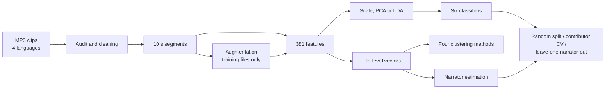

<div align="center">


</div>

# Language or Voice? Spoken Language Identification from Audiobook Clips

A classical machine-learning pipeline that tells German, Italian, Korean and Spanish apart in one-minute audiobook clips: cleaning, augmentation, 381 acoustic features, six classifiers and four clustering methods. The evaluation then asks whether the models recognise the language or only the narrator's voice.

<div align="left">

[](https://www.python.org/downloads/)
[](https://librosa.org)
[](https://scikit-learn.org)
[](https://github.com/faezehmzf/spoken-language-identification/actions/workflows/tests.yml)
[](LICENSE)

</div>

## Abstract

The dataset has 719 clips (about 12 hours) from 78 contributors, balanced over four languages and two genders. Every model is evaluated under three protocols that differ only in what may be shared between training and test data.

- **The standard split is saturated.** On a stratified 80/20 split five of six classifiers label every test file correctly, and Gaussian Naïve Bayes misses two.
- **Contributors are not speakers.** Many contributors cut their clips from the same audiobook. An audio-based grouping finds only about 24 distinct narrators, and 22 of them appear on both sides of the random split.
- **Unseen narrators: 47–73%.** With each narrator held out in turn, accuracy falls to 47–73% (chance is 25%). KNN on a three-dimensional LDA projection holds up best, and Random Forest and the RBF-SVM, which fit the training voices most closely, drop furthest.
- **Augmentation is the most effective fix tested.** Speed perturbation, pitch shifting and noise raise unseen-narrator accuracy from 47% to 62% for logistic regression. Dropping the F0 group, which includes absolute pitch, adds a further 3 points.
- **Clustering agrees.** Without labels the clips group by narrator first, then gender, then language: the silhouette-optimal clusterings have narrator NMI 0.93–0.94.

The full method, all tables and the error analysis are in the [report](REPORT.md).

## Table of Contents

1. [Key Features](#key-features)
2. [Project Workflow](#project-workflow)
3. [Results at a Glance](#results-at-a-glance)
4. [Repository Structure](#repository-structure)
5. [Installation and Usage](#installation-and-usage)
6. [Dataset](#dataset)
7. [Key Concepts](#key-concepts)
8. [Limitations](#limitations)
9. [References](#references)
10. [License](#license)

## Key Features

- **Data audit and cleaning:** corrupt, duplicate and mislabelled file checks; 16 kHz mono, DC removal and 80 Hz high-pass; long pauses capped at 0.3 s (short pauses carry rhythm); active-speech loudness normalised to −23 dBFS.
- **Augmentation for training files only:** pink noise at 10–20 dB SNR, Kaldi-style speed perturbation (×0.9 / ×1.1) and pitch shifts of ±1–3 semitones.
- **381 features per 10 s segment** in eleven named groups: MFCC with deltas, shifted delta cepstra (7-1-3-7), log-mel, spectral shape and contrast, chroma, ZCR, energy, LPC, speaker-normalised F0, and rhythm (energy modulation spectrum, onset rate, nPVI, pauses).
- **Narrator estimation:** contributors are merged when their clips are as similar to each other as clips of one contributor (distance ratio below 1.2, same language and gender).
- **Three evaluation protocols:** random 80/20, contributor-disjoint 5-fold CV and leave-one-narrator-out. Segments and augmented copies of a file never cross a split, and hyperparameters are tuned with file-grouped CV on original audio.
- **Analysis:** bootstrap confidence intervals (over narrators for the held-out-narrator protocol), accuracy against speech duration, augmentation and feature-group ablations, and K-Means, Ward, GMM and DBSCAN clusterings scored against language, gender and narrator.
- **Tests:** 17 unit tests on synthetic signals (feature dimensions, SDC values, pause capping, split leakage, narrator merging, purity), run in CI.

## Project Workflow



## Results at a Glance

File-level accuracy (about one minute of speech per decision; chance is 25%):

| Model | Random 80/20 | Contributor-disjoint CV | **Unseen narrators** |
|---|:-:|:-:|:-:|
| KNN on LDA (3-D) | 100% | 99.9% | **73.4%** |
| MLP | 100% | 99.9% | 65.2% |
| Logistic Regression | 100% | 97.6% | 61.6% |
| SVM (RBF) | 100% | 99.9% | 58.1% |
| Gaussian Naïve Bayes | 98.6% | 95.0% | 55.1% |
| Random Forest | 100% | 97.6% | 47.4% |

<p align="center">
  
  
</p>

| Finding | Interpretation |
|---|---|
| Near-perfect scores on random and contributor splits | The same voices and recordings are on both sides; the protocol cannot rank models |
| Errors on unseen narrators are concentrated in a few voices | Both German-male narrators fail; with only two per cell, the model cannot separate *German* from *that voice* |
| Accuracy is flat from 10 s to 60 s on unseen narrators | The errors are systematic per voice, so more audio per clip does not help; more narrators would |
| Log-mel alone (62%) equals all features; LPC alone is below chance (15%) | Static spectra carry language information, but vocal-tract descriptors match voices across languages |
| Typical confusions: Spanish ↔ Italian and German ↔ Korean | The first is linguistic; the second shows voice matching |

## Repository Structure

```text
spoken-language-identification/
│
├── notebooks/
│   ├── 01_Data_Cleaning_and_Feature_Extraction.ipynb   # audit, cleaning, augmentation, features, narrators, splits
│   ├── 02_Classification.ipynb                         # preprocessing, model selection, three protocols
│   ├── 03_Clustering.ipynb                             # choice of k, four algorithms, PCA and t-SNE
│   └── 04_Evaluation.ipynb                             # metrics, confusion matrices, CIs, duration, ablations
│
├── src/slid/
│   ├── config.py            # paths and signal-processing constants
│   ├── data.py              # indexing, audit, splits, narrator estimation
│   ├── cleaning.py          # cleaning, segmentation, augmentation
│   ├── features.py          # the 381 segment features
│   ├── pipeline.py          # parallel batch processing
│   ├── models.py            # classifiers, grouped CV, metrics
│   ├── clustering.py        # purity and clustering scores
│   └── plotting.py          # shared plotting style
│
├── reports/
│   ├── figures/             # every figure produced by the notebooks
│   └── results/             # metrics and predictions (CSV)
│
├── tests/                   # unit tests on synthetic signals
├── data/README.md           # expected layout (audio not included)
└── REPORT.md                # detailed report
```

The notebooks are committed with their outputs.

## Installation and Usage

```bash
git clone https://github.com/faezehmzf/spoken-language-identification.git
cd spoken-language-identification
python3 -m venv .venv
.venv/bin/pip install -r requirements.txt && .venv/bin/pip install -e .
.venv/bin/python -m pytest -q            # no audio needed
```

To rerun the experiments, put the audio in `data/raw/<Language>/<Gender>/*.mp3` (see [data/README.md](data/README.md)) or set `SLID_DATA_DIR`, then run the notebooks in order:

```bash
export SLID_DATA_DIR=/path/to/dataset
.venv/bin/jupyter nbconvert --to notebook --execute --inplace notebooks/0*.ipynb
```

Feature extraction takes about 30 minutes on a 10-core laptop and is cached in `data/processed/`. Classification, including the 24 leave-one-narrator-out folds, takes about 20 minutes more.

## Dataset

| | German | Italian | Korean | Spanish |
|---|:-:|:-:|:-:|:-:|
| clips (female / male) | 90 / 90 | 90 / 89 | 90 / 90 | 90 / 90 |
| contributors | 28 | 18 | 14 | 18 |
| estimated narrators | 5 | 9 | 5 | 5 |

About one-minute MP3 clips cut at sentence boundaries from public audiobooks and podcasts (44.1 or 48 kHz, mono or stereo). The audit found no corrupt files or exact duplicates. File-name problems (double extensions, a language typo) do not matter because labels come from folders. One 25-minute upload that contains the full source of a contributor's other clips was excluded. The audio is **not included**; contributor IDs are replaced by anonymous codes.

## Key Concepts

- Acoustic language identification: MFCC, shifted delta cepstra, prosody and rhythm features.
- Speed perturbation and pitch shifting as speaker augmentation.
- Group-aware evaluation: why splitting by file, contributor or speaker gives different answers.
- Linear discriminant analysis as a projection that suppresses within-class (speaker) variation.
- Choosing the number of clusters (elbow, silhouette, BIC) and comparing clusterings with purity, ARI and NMI.
- Bootstrap confidence intervals when test items are not independent.

## Limitations

- Narrator groups are estimated from audio. Knowing which audiobook each contributor used would give the exact grouping.
- Many language-gender cells have only two narrators, so held-out-narrator results have wide intervals.
- All models are classical. Speaker-invariant representations (x-vector or ECAPA language embeddings, wav2vec 2.0 / XLS-R, narrator-adversarial training) and phonotactic models are the natural next step.

See the [report](REPORT.md#9-limitations) for details.

## References

- P. A. Torres-Carrasquillo et al. (2002). Approaches to Language Identification Using Gaussian Mixture Models and Shifted Delta Cepstral Features. *ICSLP*.
- T. Ko, V. Peddinti, D. Povey & S. Khudanpur (2015). Audio Augmentation for Speech Recognition. *Interspeech*.
- H. Li, B. Ma & K. A. Lee (2013). Spoken Language Recognition: From Fundamentals to Practice. *Proceedings of the IEEE* 101(5).
- E. Grabe & E. L. Low (2002). Durational Variability in Speech and the Rhythm Class Hypothesis. *Laboratory Phonology 7*.
- M. Mauch & S. Dixon (2014). pYIN: A Fundamental Frequency Estimator Using Probabilistic Threshold Distributions. *ICASSP*.

## License

The code is released under the [MIT licence](LICENSE). The audio is not included.

<div align="center">

</div>
