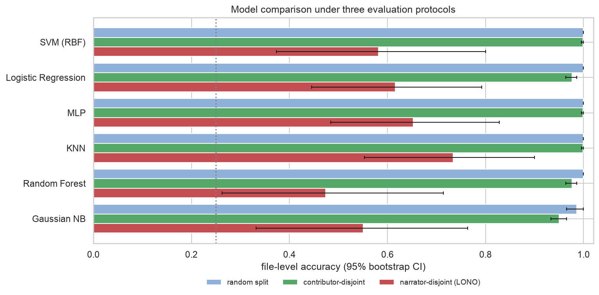
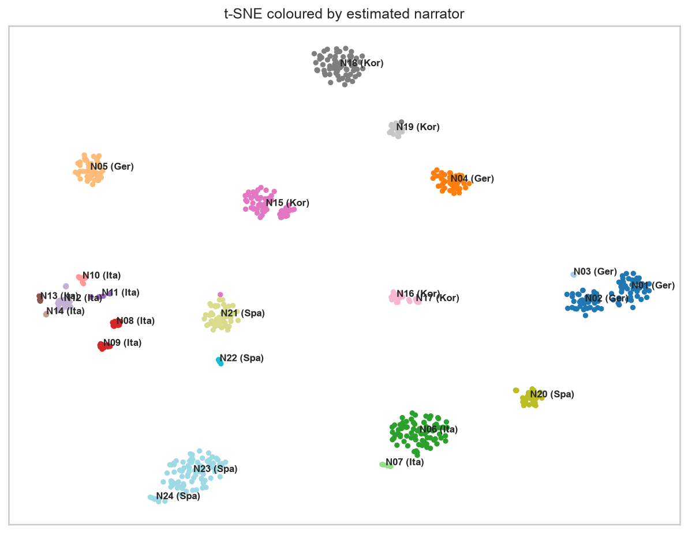

# Spoken Language Identification from Audiobook Speech

Classical machine-learning pipeline that identifies the spoken language — **German, Italian, Korean or Spanish** — of
short audiobook clips: audio cleaning and augmentation, 381 hand-crafted acoustic features, six classifiers, four
clustering algorithms, and an evaluation that asks whether the models recognise the **language** or the **voice**.

<p align="center"></p>

## Results at a glance

| Model | Random 80/20 split | Contributor-disjoint CV | **Unseen narrators (LONO)** |
|---|:-:|:-:|:-:|
| KNN on LDA (3-D) | 100 % | 99.9 % | **73.4 %** |
| MLP | 100 % | 99.9 % | 65.2 % |
| Logistic Regression | 100 % | 97.6 % | 61.6 % |
| SVM (RBF) | 100 % | 99.9 % | 58.1 % |
| Gaussian Naïve Bayes | 98.6 % | 95.0 % | 55.1 % |
| Random Forest | 100 % | 97.6 % | 47.4 % |

File-level accuracy (≈ 1 min of speech per decision); chance level is 25 %.

**Main finding.** A standard stratified split gives near-perfect scores, but the 719 clips come from only
**~24 distinct narrators**: many contributors cut their clips from the same audiobook. Held-out *narrators* bring accuracy
down to 47–73 %. The near-perfect scores mostly reflect recognising voices and recordings. The same picture appears
without labels: the clusters correspond to narrators, not languages.

<p align="center"><br>
<em>t-SNE of file-level features: each tight island is one narrator / audiobook.</em></p>

Other findings:

* **Augmentation matters most for new voices:** speed perturbation, pitch shift and noise raise unseen-narrator accuracy
  from 47 % to 62 % (Logistic Regression).
* **LDA + KNN generalises best.** Flexible models (Random Forest, RBF-SVM) overfit narrator-specific cues such as
  chroma and voicing ratio.
* **Log-mel energies alone** match the full feature set. Removing absolute-pitch features *improves* generalisation.
* **More speech does not fix unseen-narrator errors:** with new voices, accuracy is flat from 10 s to 60 s because the errors
  are systematic per voice. Typical confusions: Spanish ↔ Italian (linguistically close) and German ↔ Korean
  (voice similarity).

## Dataset

| | German | Italian | Korean | Spanish |
|---|:-:|:-:|:-:|:-:|
| clips (female / male) | 90 / 90 | 90 / 89 | 90 / 90 | 90 / 90 |
| contributors | 28 | 18 | 14 | 18 |
| estimated narrators | 5 | 9 | 5 | 5 |

About 12 hours of speech in ~1-minute MP3 clips, cut at sentence boundaries from public audiobooks and podcasts
(44.1/48 kHz, mono/stereo). The audio is **not included** in this repository.

Data audit (notebook 1): no corrupt files or duplicates. File-name inconsistencies (double extensions, typos) are
ignored because labels come from folders. One 25-minute upload of a complete source, which overlaps that contributor's
other clips, was excluded.

## Pipeline

```
MP3 ─► cleaning ─► 10 s segments ─► augmentation (train only) ─► 381 features ─► scale / PCA / LDA ─► classifiers
                                                                        └──────► file-level vectors ─► clustering
```

**Cleaning.** Resample to 16 kHz mono, remove DC, 80 Hz high-pass, shorten pauses longer than 0.3 s (short pauses carry
rhythm), and normalise active-speech loudness to −23 dBFS. No spectral denoising: estimated SNR is 34–44 dB.

**Augmentation** (training files only): pink noise at 10–20 dB SNR, speed perturbation ×0.9/×1.1, pitch shift ±1–3
semitones.

**Features** (per 10 s segment, 25 ms frames / 10 ms hop):

| Group | Dim | Captures |
|---|:-:|---|
| MFCC + Δ + ΔΔ | 120 | spectral envelope, phonetic content |
| Shifted Delta Cepstra (7-1-3-7) | 98 | phone-sequence dynamics; classic LID feature |
| Log-mel (40 bands) | 80 | spectral energy distribution |
| Spectral centroid / bandwidth / roll-off / flatness | 8 | brightness, noisiness |
| Spectral contrast | 14 | harmonic peaks vs valleys |
| Chroma | 24 | pitch-class energy (baseline) |
| ZCR, RMS energy | 4 | voicing balance, dynamics |
| LPC (order 12) | 12 | vocal-tract model |
| F0 / intonation (pYIN, semitones re. speaker median) | 7 | intonation range and movement |
| Rhythm (energy modulation spectrum, onset rate, nPVI, pauses) | 14 | stress- vs syllable-timing |

**Classifiers:** Logistic Regression, RBF-SVM, KNN (+PCA/LDA), Random Forest, MLP, Gaussian NB. Hyper-parameters are
tuned by grid search with file-grouped CV. Segment probabilities are averaged to give one decision per file.

**Clustering:** K-Means, Ward agglomerative, GMM (BIC) and DBSCAN on standardised, PCA-reduced file vectors. k is
chosen by elbow, silhouette and BIC. Clusters are scored with silhouette, purity, ARI and NMI against language, gender and
narrator.

**Evaluation protocols**

1. **Random 80/20** stratified by language × gender, split by file. Segments and augmented copies never cross the split.
2. **Contributor-disjoint** 5-fold CV.
3. **Leave-one-narrator-out (LONO).** Narrators are estimated by merging contributors whose clips are as similar to
   each other as clips within one contributor (between/within distance ratio < 1.2, same language and gender).

## Repository structure

```
notebooks/
  01_Data_Cleaning_and_Feature_Extraction.ipynb   audit, cleaning, augmentation, features, narrator analysis, splits
  02_Classification.ipynb                         preprocessing, model selection, three evaluation protocols
  03_Clustering.ipynb                             k selection, 4 algorithms, cluster composition, PCA / t-SNE
  04_Evaluation.ipynb                             metrics, confusion matrices, CIs, duration analysis, ablations
src/slid/
  config.py      paths and signal-processing constants
  data.py        indexing, audit, splits, narrator estimation
  cleaning.py    cleaning, segmentation, augmentation
  features.py    feature extraction
  pipeline.py    parallel batch processing
  models.py      model zoo, CV splits, metrics
  clustering.py  purity and clustering metrics
  plotting.py    shared plotting helpers
reports/
  figures/       all figures produced by the notebooks
  results/       metrics and predictions (CSV)
```

All notebooks are committed already executed.

## Reproducing

```bash
python -m venv .venv && source .venv/bin/activate
pip install -r requirements.txt && pip install -e .
```

Put the audio in `data/raw/<Language>/<Gender>/*.mp3`, or point to it with an environment variable:

```bash
export SLID_DATA_DIR=/path/to/dataset
```

Then run the notebooks in order. Feature extraction takes about 30 minutes on a 10-core laptop and is cached in
`data/processed/`. The full classification run, including leave-one-narrator-out, takes about 20 minutes.

## Limitations and next steps

* Narrator groups are estimated from audio. The source assignment of each contributor would give the exact grouping.
* Many language × gender cells have only two narrators. More voices would help more than more audio per voice.
* Speaker-invariant representations are the natural next step: x-vector / ECAPA language embeddings, self-supervised
  speech models (wav2vec 2.0 / XLS-R), narrator-adversarial training, or phonotactic (phone n-gram) models.
