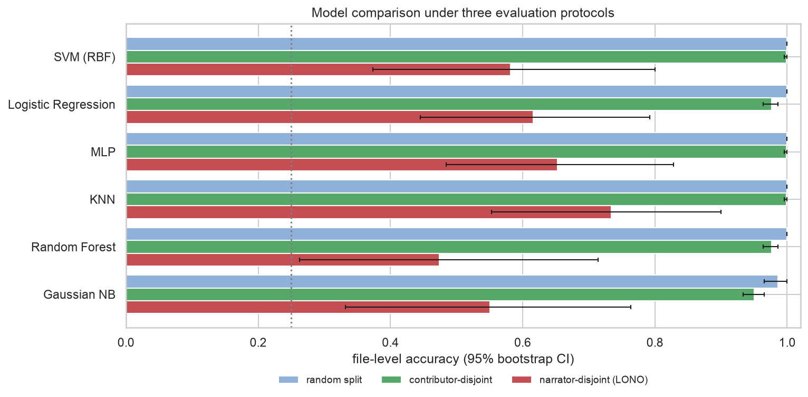
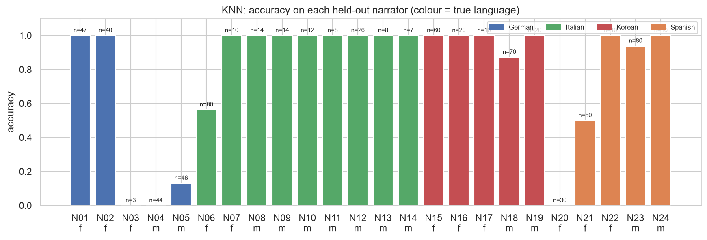
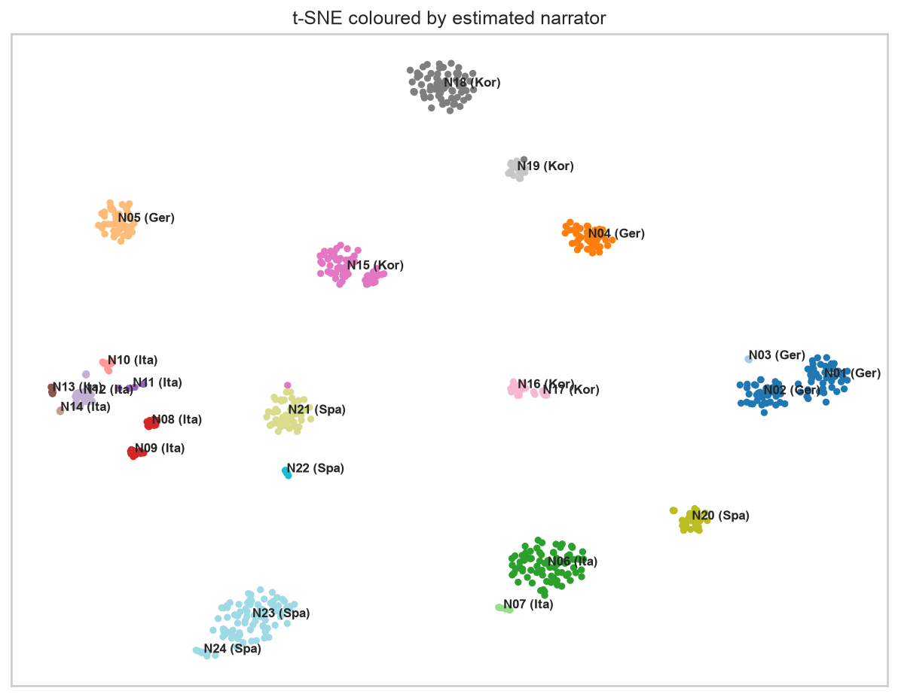

# Report: Spoken Language Identification and the Narrator Problem

All numbers below come from the executed notebooks and the CSV files in [`reports/results/`](reports/results). Accuracy is file-level (about one minute of speech per decision) unless stated otherwise; chance is 25%.

## Contents

1. [Questions](#1-questions)
2. [Data and audit](#2-data-and-audit)
3. [Cleaning, segmentation and augmentation](#3-cleaning-segmentation-and-augmentation)
4. [Features](#4-features)
5. [Contributors, narrators and evaluation protocols](#5-contributors-narrators-and-evaluation-protocols)
6. [Classification results](#6-classification-results)
7. [Ablations](#7-ablations)
8. [Clustering](#8-clustering)
9. [Limitations](#9-limitations)
10. [Reproducibility](#10-reproducibility)
11. [References](#11-references)

## 1. Questions

1. How well can classical acoustic features and standard classifiers identify German, Italian, Korean and Spanish in one-minute clips?
2. Do high scores mean the model recognises the *language*, or the *voice and recording* it has already heard?
3. Which models, features and augmentations still work on narrators that were never seen in training?
4. Without labels, what does the feature space organise around?

## 2. Data and audit

The raw data are 720 MP3 clips (12.6 hours) in `Language/Gender` folders, 90 clips per language and gender, from 78 contributors. Each contributor cut 2–20 clips at sentence boundaries from one audiobook or podcast. Labels are taken from the folders. Contributor IDs from the file names are replaced by anonymous codes (`S01` … `S78`).

| Check | Files |
|---|---:|
| unreadable | 0 |
| exact duplicates (MD5) | 0 |
| double extension (`.mp3.mp3`) | 31 |
| language typo in the name (`koren`) | 10 |
| gender in the name differs from the folder | 0 |
| shorter than 45 s | 7 |
| longer than 180 s | 1 |

Double extensions and name typos are harmless because labels come from folders. The one long file is a 25.6-minute Italian upload that contains the full source of the same contributor's other clips. Keeping it would duplicate content and could leak between training and test data, so it is excluded. **719 clips (12.2 hours) remain.**

Sources are mixed (44.1 and 48 kHz, mono and stereo). The class balance holds at the language level but not at the contributor level: German has 28 contributors, Korean 14.

## 3. Cleaning, segmentation and augmentation

Audiobook recordings are already clean (estimated SNR 34–44 dB per language), so cleaning aims at consistency rather than denoising. Aggressive denoising could remove language cues and add artefacts.

1. **Resample to 16 kHz mono.** Speech lies below 8 kHz, and one sample rate makes features comparable.
2. **DC removal and a 4th-order 80 Hz high-pass** against rumble and hum.
3. **Pause shortening.** Frames 35 dB below the peak are silence. Pauses longer than 0.3 s are cut to 0.3 s and shorter ones are kept, because pause patterns are part of rhythm. This removes 5–18% of a clip, most for Korean and least for Italian.
4. **Loudness normalisation** of active speech to −23 dBFS RMS, then peak limiting, so recording gain does not become a feature.

Each cleaned clip is cut into non-overlapping 10 s segments; a tail of at least 5 s is kept. This gives 3,920 original segments.

**Augmentation** produces one noisy, one speed-perturbed and one pitch-shifted copy of every clip:

| Augmentation | Simulates | Setting |
|---|---|---|
| noise | poorer recordings | pink (1/f) noise at a random SNR of 10–20 dB |
| speed | speaking rate and voice | resampling by ×0.9 or ×1.1 (Ko et al., 2015) |
| pitch | other speakers | ±1–3 semitones, tempo unchanged |

Copies exist for every file, but only copies of *training* files are used for training. Test and validation files are always scored on original audio.

## 4. Features

Each segment becomes a 381-dimensional vector of statistics over 25 ms frames with a 10 ms hop. Column names start with their group, which makes the ablations in §7 simple.

| Group | Dim | What it describes |
|---|:-:|---|
| MFCC + Δ + ΔΔ (mean, std) | 120 | spectral envelope: which sounds occur and how fast they change |
| Shifted delta cepstra 7-1-3-7 | 98 | cepstral changes stacked over about 0.2 s, a classic acoustic LID feature (Torres-Carrasquillo et al., 2002); computed on mean-normalised cepstra |
| Log-mel, 40 bands | 80 | spectral energy distribution |
| Centroid, bandwidth, roll-off, flatness | 8 | brightness and noisiness |
| Spectral contrast | 14 | harmonic peaks against valleys per sub-band |
| Chroma | 24 | pitch-class energy, a music feature kept as a weak baseline |
| ZCR, RMS energy | 4 | voicing balance and dynamics |
| LPC, order 12 | 12 | all-pole vocal-tract model |
| F0 (pYIN), in semitones relative to the speaker's median | 7 | intonation range and movement, plus median pitch and voiced ratio |
| Rhythm | 14 | modulation spectrum of the energy envelope, onset rate, IOI variability, nPVI, pause ratio |

PLP was left out: it carries much the same information as MFCC.

On training files, the ANOVA F-statistics agree with phonetic intuition. Korean has the lowest onset rate (about 3.8 against 4.5 events/s). Spanish narrators have the widest intonation range even after pitch normalisation. German has the highest spectral centroid and ZCR, consistent with many fricatives and consonant clusters. Chroma also scores high, which is a first sign of narrator effects, since chroma is not a language feature.

## 5. Contributors, narrators and evaluation protocols

### 5.1 Contributors are not narrators

Several contributors cut clips from the *same* audiobook, at different time ranges. Two checks on file-level vectors (mean of segment features, standardised) show how much:

- A classifier that tries to identify the contributor reaches only 67.9% (77 classes), while language identification on the same features is about 99%. Many contributors cannot be told apart.
- For each pair of contributors with the same language and gender, the **distance ratio** is the mean distance between their clips divided by the geometric mean of their within-contributor distances. A ratio near 1 means the two sets of clips are as alike as clips from one recording.

Where the ratio distribution has a clear gap (Spanish female: ≤ 1.10 against ≥ 1.85; Korean female: ≤ 1.06 against ≥ 1.31), it separates same from different recordings. Contributors are therefore merged by average linkage at a ratio of 1.2.

| Language | Gender | Contributors | Estimated narrators |
|---|---|:-:|:-:|
| German | female | 16 | 3 |
| German | male | 12 | 2 |
| Italian | female | 10 | 2 |
| Italian | male | 8 | 7 |
| Korean | female | 7 | 3 |
| Korean | male | 7 | 2 |
| Spanish | female | 9 | 3 |
| Spanish | male | 9 | 2 |
| **all** | | **78** | **24** |

### 5.2 Protocols

| Protocol | Grouping | Question it answers |
|---|---|---|
| Random 80/20 | files, stratified by language × gender (575 train, 144 test) | new clips of narrators already heard |
| Contributor-disjoint 5-fold CV | `StratifiedGroupKFold` on contributor | what is usually called speaker-independent |
| Leave-one-narrator-out (LONO) | 24 folds, one estimated narrator held out | a voice never heard in training |

In every protocol all segments and augmented copies of a file stay on one side. Still, 62 of 78 contributors and 22 of 24 narrators appear on both sides of the random split, and 13 of 24 narrators are spread over more than one contributor fold.

### 5.3 Models and tuning

Every model is a pipeline of median imputation (a few F0 and rhythm values are undefined in almost unvoiced segments), standardisation, optional reduction, and the classifier. Hyperparameters are tuned by grid search with 5-fold CV inside the random-split training set, grouped by file, training on augmented data and validating on original audio; the score is segment macro-F1. The grouped-protocol runs reuse these settings without re-tuning.

| Model | Grid | Selected | CV macro-F1 |
|---|---|---|:-:|
| Logistic Regression | C ∈ {0.01, 0.1, 1} | C = 0.1 | 0.997 |
| SVM (RBF) | C ∈ {1, 10}, γ ∈ {scale, 0.001} | C = 1, γ = scale | 0.999 |
| KNN | PCA or LDA; k ∈ {5, 15, 31}; distance weights | LDA (3-D), k = 15 | 0.998 |
| Random Forest | 400 trees; max_features ∈ {sqrt, 0.1}; min leaf ∈ {1, 3} | sqrt, 1 | 0.999 |
| MLP (256-64, early stopping) | α ∈ {0.001, 0.01, 0.1} | α = 0.1 | 0.998 |
| Gaussian NB on PCA (95% variance) | var_smoothing ∈ {1e-9, 1e-6} | 1e-9 | 0.955 |

The CV scores are all near 1, so model selection on this protocol says little. §6 shows why.

A file's prediction is the argmax of its segments' mean class probabilities.

## 6. Classification results

### 6.1 Three protocols

File-level accuracy with 95% bootstrap intervals. Files are resampled for the first two protocols; for LONO *narrators* are resampled, because files of one narrator are not independent.

| Model | Random 80/20 | Contributor-disjoint | LONO | LONO 95% CI |
|---|:-:|:-:|:-:|:-:|
| KNN on LDA | 1.000 | 0.999 | **0.734** | 0.55–0.90 |
| MLP | 1.000 | 0.999 | 0.652 | 0.48–0.83 |
| Logistic Regression | 1.000 | 0.976 | 0.616 | 0.44–0.79 |
| SVM (RBF) | 1.000 | 0.999 | 0.581 | 0.37–0.80 |
| Gaussian NB | 0.986 | 0.950 | 0.551 | 0.33–0.76 |
| Random Forest | 1.000 | 0.976 | 0.474 | 0.26–0.71 |



- **Random split: saturated.** Five models classify all 144 test files correctly; on 10 s segments they reach 99.6–99.9%. Gaussian NB misses two Spanish files, labelled Italian. 16 of its 29 segment errors are Spanish → Italian, the closest pair in the data.
- **Contributor-disjoint: barely harder** (95.0–99.9%), because a "new" contributor usually reads from an audiobook the model already knows.
- **LONO: the ranking changes.** The models that fit training data most flexibly, Random Forest and the RBF-SVM, transfer worst. LDA keeps only the three directions that maximise between-language relative to within-language variance. Differences between narrators of one language count as within-language variance, so LDA suppresses many voice-specific directions, and a neighbour vote in that space transfers best.

The intervals are wide: with 24 narrators, one voice moves accuracy by several points, so the middle of the ranking (MLP, LR, SVM, NB) is not well separated.

### 6.2 Where the errors are

KNN, file-level confusion matrix under LONO (rows: true language):

| | German | Italian | Korean | Spanish | Recall |
|---|:-:|:-:|:-:|:-:|:-:|
| **German** | 93 | 41 | 46 | 0 | 0.52 |
| **Italian** | 24 | 144 | 7 | 4 | 0.80 |
| **Korean** | 9 | 0 | 171 | 0 | 0.95 |
| **Spanish** | 37 | 23 | 0 | 120 | 0.67 |

Korean is recognised best. Spanish is rarely predicted wrongly (precision 0.97) but often missed. German is hardest (F1 0.54). Two confusion patterns appear in every model: Spanish ↔ Italian, which is linguistically plausible, and German ↔ Korean, which is not and points to voice matching. For Random Forest the second pattern dominates: 116 of 180 Korean files are labelled German and 81 of 180 German files Korean.



Errors are concentrated in a few narrators. 16 of 24 are classified perfectly and two more above 85% (N18, N23). Both German-male narrators fail (N04: 0% of 44 files, mostly labelled Korean; N05: 13% of 46). German male has only two narrators, so when one is held out the model has seen a single German male voice and cannot tell which properties belong to German and which to that voice. One Spanish-female narrator (N20, 30 files) is labelled German throughout, the smallest German-female group (N03, 3 files) is missed, and two large narrators are split (N06 Italian female 56%, N21 Spanish female 50%).

### 6.3 How much speech is needed?

The file decision is recomputed from only the first *n* segments:

| Speech used | 10 s | 20 s | 30 s | 40 s | 50 s | 60 s |
|---|:-:|:-:|:-:|:-:|:-:|:-:|
| KNN, random split | 1.000 | 0.993 | 1.000 | 1.000 | 1.000 | 1.000 |
| KNN, LONO | 0.718 | 0.709 | 0.733 | 0.729 | 0.732 | 0.733 |
| LR, LONO | 0.605 | 0.609 | 0.622 | 0.622 | 0.618 | 0.618 |

On known narrators 10–30 s is enough. On unseen narrators accuracy is flat: the errors are systematic for a voice, not noise that averaging removes. More narrators would help; more audio per narrator does not.

## 7. Ablations

Logistic Regression (fast, and mid-ranked in every protocol) is retrained under LONO.

| Setting | Features | File accuracy | Macro-F1 |
|---|:-:|:-:|:-:|
| all features, with augmentation | 381 | **0.616** | 0.626 |
| all features, without augmentation | 381 | 0.470 | 0.485 |
| channel-robust set (MFCC Δ/ΔΔ, SDC, F0 in semitones, rhythm) | 199 | 0.579 | 0.589 |

**Augmentation is the largest single gain: +14.6 points.** Speed and pitch perturbation create "new" voices, which is exactly what the training data lack. On the random split it changes nothing, because that protocol is already saturated.

The channel-robust set drops static spectral colour by construction and reaches 0.579, slightly below all features: static spectra carry language information (the sound inventory) as well as voice and microphone.

| Group | Dim | Only this group | All minus this group (change) |
|---|:-:|:-:|:-:|
| mel | 80 | 0.618 | +0.001 |
| mfcc | 120 | 0.495 | +0.011 |
| contrast | 14 | 0.458 | −0.006 |
| sdc | 98 | 0.426 | +0.008 |
| spec | 8 | 0.330 | +0.008 |
| rhythm | 14 | 0.327 | +0.010 |
| f0 | 7 | 0.309 | **+0.031** |
| zcr | 2 | 0.275 | −0.008 |
| chroma | 24 | 0.255 | 0.000 |
| rms | 2 | 0.214 | −0.006 |
| lpc | 12 | 0.154 | −0.001 |

- Log-mel alone matches the full set. Chroma alone is at chance, and LPC alone is *below* chance: its vocal-tract description matches voices across languages, so it misleads systematically on new narrators.
- No single group matters much once the others are present (changes of at most 3 points). Removing the F0 group *improves* accuracy by 3 points: median pitch and voiced ratio are narrator cues.
- Random Forest importances on the random split rank mel, MFCC and chroma highest, with `f0_voiced_ratio` the single top feature. These are the narrator-specific cues that do not transfer, which fits the forest being the weakest LONO model.

## 8. Clustering

One vector per file (mean of its original segments), standardised and reduced by PCA to 78 components (95% of the variance). Four algorithms are run with k = 4 and with their own data-driven k.

- **Choosing k.** The inertia curve has no sharp elbow (the knee heuristic gives 12 over 2–30). The silhouette rises from 0.21 at k = 4 to 0.31 at k = 15–16 for K-Means, Ward and GMM. GMM's BIC is lowest at k = 10. DBSCAN's `eps` comes from the knee of the 10-nearest-neighbour distance curve.

| Clustering | k | Silhouette | Purity (language) | ARI (language) | Purity (gender) | NMI (narrator) |
|---|:-:|:-:|:-:|:-:|:-:|:-:|
| K-Means | 4 | 0.21 | 0.58 | 0.28 | 0.82 | 0.62 |
| Ward | 4 | 0.20 | 0.58 | 0.28 | 0.81 | 0.63 |
| GMM | 4 | 0.14 | 0.60 | 0.28 | 0.83 | 0.58 |
| K-Means | 15 | 0.31 | 0.99 | 0.43 | 1.00 | 0.93 |
| Ward | 16 | 0.31 | 1.00 | 0.42 | 1.00 | 0.94 |
| GMM (BIC) | 10 | 0.25 | 0.88 | 0.39 | 0.90 | 0.85 |
| DBSCAN (5% noise) | 14 | 0.29 | 0.89 | 0.38 | 0.95 | 0.92 |

Random clusters would give a language purity of about 0.25 and ARI 0.

- At **k = 4** clusters agree with language only weakly and more with gender. They are made of whole narrators: one K-Means cluster is exactly the 90 Spanish-male files, another combines Korean male, part of Korean female and half of German male.
- At the **silhouette-optimal k** clusters are language-pure, but only because each one is essentially a single narrator and every narrator reads one language.
- **t-SNE** shows about 20 tight islands, one per narrator. A language is a set of separate voice islands, not a region.



Without labels, the feature space is organised by narrator first, gender second and language third. This is the unsupervised side of the effect that makes the random split look solved.

## 9. Limitations

- **Narrator groups are estimated.** The 1.2 threshold sits in a clear gap for most cells, but knowing which audiobook each contributor used would give the exact grouping. An error here moves files between LONO folds, not labels.
- **Few voices per cell.** Many language-gender cells have two narrators, so LONO intervals are wide and per-language results depend on one or two voices.
- **Tuning on the easy protocol.** Hyperparameters were chosen on the random split, where every setting scores near 1. Tuning inside LONO folds could change the order of the middle-ranked models.
- **Classical features only.** Speaker-invariant representations are the natural next step: x-vector or ECAPA language embeddings, self-supervised models such as wav2vec 2.0 / XLS-R, narrator-adversarial training, or phonotactic models (phone recognisers with n-gram language models), which depend on phone sequences rather than timbre.

## 10. Reproducibility

```bash
python3 -m venv .venv
.venv/bin/pip install -r requirements.txt && .venv/bin/pip install -e .
.venv/bin/python -m pytest -q                         # synthetic tests, no audio needed
export SLID_DATA_DIR=/path/to/dataset                 # layout in data/README.md
.venv/bin/jupyter nbconvert --to notebook --execute --inplace notebooks/0*.ipynb
```

`requirements.txt` pins the versions that produced the committed outputs. The random seed is fixed (`RANDOM_STATE = 42`) for splits, folds, augmentation and models. Feature extraction takes about 30 minutes on a 10-core laptop; classification with all 24 LONO folds about 20 minutes.

## 11. References

- P. A. Torres-Carrasquillo, E. Singer, M. A. Kohler, R. J. Greene, D. A. Reynolds & J. R. Deller (2002). Approaches to Language Identification Using Gaussian Mixture Models and Shifted Delta Cepstral Features. *ICSLP*.
- T. Ko, V. Peddinti, D. Povey & S. Khudanpur (2015). Audio Augmentation for Speech Recognition. *Interspeech*.
- H. Li, B. Ma & K. A. Lee (2013). Spoken Language Recognition: From Fundamentals to Practice. *Proceedings of the IEEE* 101(5).
- E. Grabe & E. L. Low (2002). Durational Variability in Speech and the Rhythm Class Hypothesis. *Laboratory Phonology 7*.
- M. Mauch & S. Dixon (2014). pYIN: A Fundamental Frequency Estimator Using Probabilistic Threshold Distributions. *ICASSP*.
- D. Snyder, D. Garcia-Romero, A. McCree, G. Sell, D. Povey & S. Khudanpur (2018). Spoken Language Recognition using X-vectors. *Odyssey*.
- L. van der Maaten & G. Hinton (2008). Visualizing Data using t-SNE. *JMLR* 9.
